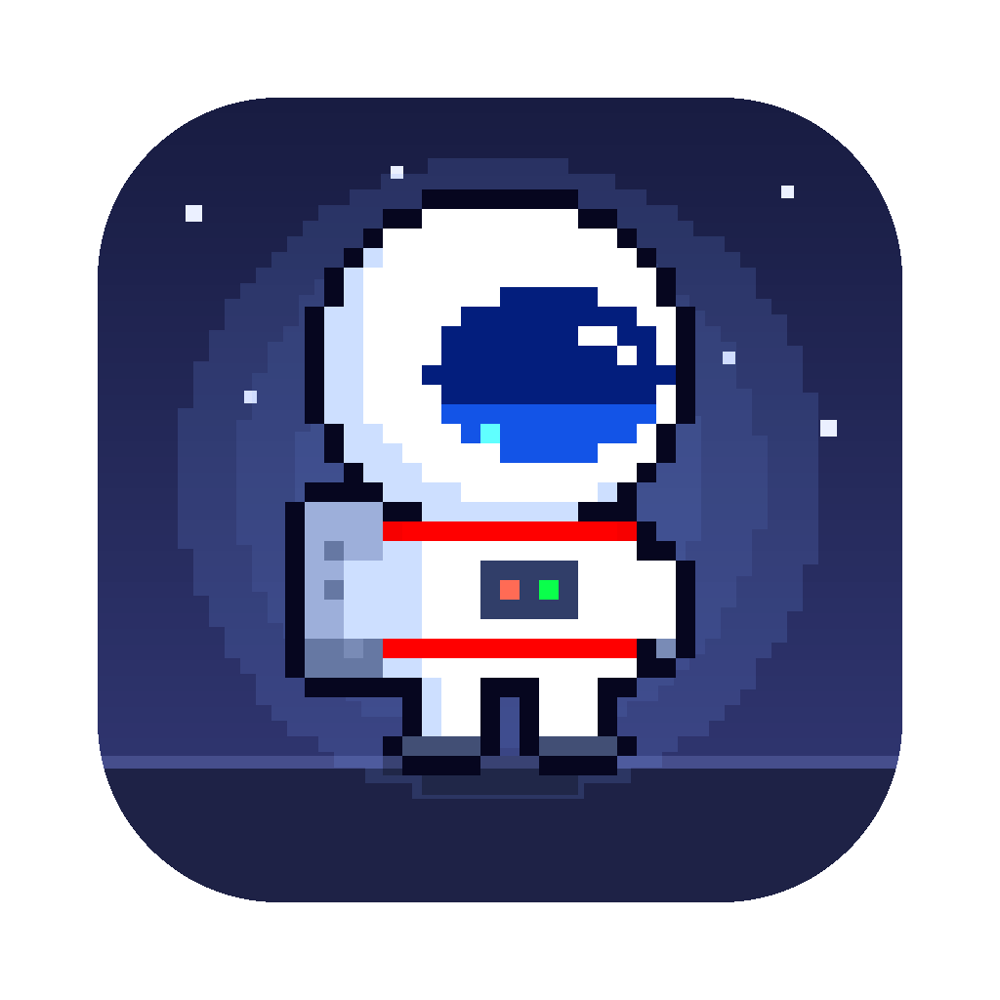
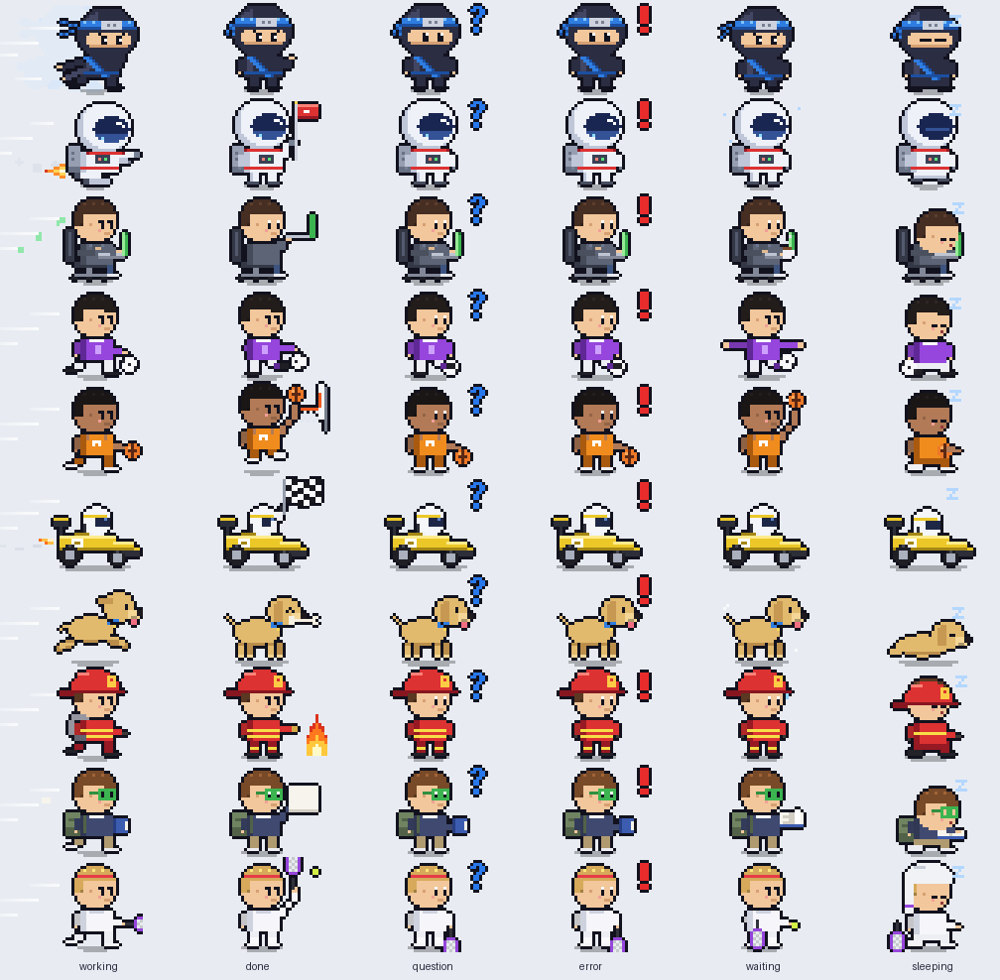

<p align="center"></p>

# PixelBuddy

A tiny pixel art buddy that lives above your Dock on macOS, reacts to what **Claude Code**
is doing, and shows your calendar with one click. Pick one of **10 characters**: ninja,
astronaut, developer, footballer, basketball player, F1 driver, dog, firefighter, student or
tennis player.

<p align="center"></p>

*[Leer en español ↓](#español)*

| Claude Code… | Your buddy |
|---|---|
| is working | runs, flies, dribbles or drives back and forth |
| finished | celebrates for 30 s (katana, flag, goal, basket, A+…) |
| asks you something or needs permission | blue **?** |
| stopped on an error | red **!** |
| waits for your next message | trains, stretches, juggles, reads… (1 min) |
| has been idle | sleeps, Zzz |

- One buddy per Claude Code session, each in its own color (blue, red, green, purple, orange,
  yellow) — the dog changes breed instead.
- Click a buddy to see your current event and your next one today, from the macOS Calendar
  (iCloud, Google… any account added in *System Settings › Internet Accounts*).
- It only reacts to sessions opened in **your project folder** (and its subfolders).
- Native Swift app, no dependencies, no network, free.

## Requirements

- macOS 14 Sonoma or later
- Xcode Command Line Tools (`xcode-select --install`; full Xcode is not needed)
- Claude Code (desktop app or CLI)

## Install

```bash
git clone https://github.com/rubenbenitoferrando-sketch/PixelBuddy.git
cd PixelBuddy
./scripts/install.sh
```

The script builds the app on your Mac and installs it in `~/Applications`. PixelBuddy then
opens a welcome window where you:

1. pick your character,
2. choose your project folder — and tick **Connect Claude Code** (it adds PixelBuddy's hooks
   to that folder's personal `.claude/settings.local.json`, backing it up first),
3. optionally allow Calendar access.

Close and reopen your Claude Code sessions in that folder, and your buddy comes to life.

### Prefer the Claude Code plugin?

Instead of ticking *Connect Claude Code*, you can install the hooks as a plugin. Inside a
Claude Code session opened in your project folder:

```
/plugin marketplace add rubenbenitoferrando-sketch/PixelBuddy
/plugin install pixelbuddy@pixelbuddy
```

Choose the **local** scope (only this project, only you). You still need the app: the plugin
just tells it what Claude Code is doing.

## Using it

- **Click a buddy** → speech bubble with your current event (and when it ends) and your next
  one today, or "You can relax". It closes on the next click or after 8 seconds.
- **✕ Remove** in the bubble removes a buddy whose session you no longer use. If that session
  starts working again, its buddy comes back. When there are no sessions, a main buddy stays
  so you can always check your calendar.
- **Menu bar icon**: character, show/hide, calendars, watched folder, set up, **How It Works…** (a short animated guide that also opens right after the welcome window), open at login, quit.

## Privacy

Everything stays on your Mac. The hook writes one small file per session to
`~/Library/Application Support/PixelBuddy/sessions/` with the session id, folder, event name,
tool name or notification type, and time — nothing from your prompts or code. Events from
other folders are ignored. The calendar is read locally through EventKit. PixelBuddy makes no
network requests.

## Uninstall

```bash
./scripts/uninstall.sh
```

It removes the hooks from your project folder, the login item, the app, its data and its
settings (backups of `settings.local.json` are kept). If you used the plugin:
`/plugin uninstall pixelbuddy@pixelbuddy`.

## Add your own character

Each character is a folder in `assets/avatars/<id>/` with a `manifest.json` and one sprite
strip per color and state (`<prefix>_<color>_<state>.png`, 32×32 frames; states `idle`, `run`,
`katana`, `train`, `sleep`, `alert`, `ask`). The app finds new folders automatically.
The ninja and astronaut are generated with `tools/make_sprites.py` and
`tools/make_astronaut.py`; the other eight with `tools/make_characters.py` from
`tools/chars/` (they all need Pillow). `tools/preview_characters.py` makes a preview GIF.

## Development

- Swift Package (macOS 14+) in `Sources/PixelBuddy/`. `scripts/build_app.sh` builds with
  `swift build -c release`, assembles `PixelBuddy.app`, signs it and installs it.
- `scripts/simulate.sh` plays fake sessions through every state, without real work.
- Optional: `scripts/create_signing_cert.sh` creates a local signing certificate so macOS
  keeps the Calendar permission across rebuilds (asks for your Mac password once).
- The hook script is `plugins/pixelbuddy/scripts/pixelbuddy-hook.sh`; the plugin catalog is
  `.claude-plugin/marketplace.json`.

PixelBuddy is an independent project, not affiliated with or endorsed by Anthropic.
Claude and Claude Code are trademarks of Anthropic.

---

## Español

Un compañero pixel art que vive encima del Dock, reacciona a lo que hace **Claude Code** y te
enseña tu calendario con un clic. Hay **10 personajes**: ninja, astronauta, programador,
futbolista, baloncestista, piloto de F1, perro, bombero, estudiante y tenista.

**Requisitos:** macOS 14 o posterior, Command Line Tools de Xcode
(`xcode-select --install`) y Claude Code.

**Instalar:**

```bash
git clone https://github.com/rubenbenitoferrando-sketch/PixelBuddy.git
cd PixelBuddy
./scripts/install.sh
```

La app se abre con una ventana de bienvenida: elige tu personaje, tu carpeta de proyecto
(marca **Conectar Claude Code**) y, si quieres, da acceso al Calendario. Después cierra y
vuelve a abrir tus sesiones de Claude Code en esa carpeta.

**Con el plugin** (en vez de "Conectar Claude Code"), dentro de una sesión en tu carpeta:
`/plugin marketplace add rubenbenitoferrando-sketch/PixelBuddy` y `/plugin install pixelbuddy@pixelbuddy`, con
alcance **local**.

**Uso:** clic en el personaje → evento actual y el siguiente de hoy (o "Puedes descansar").
**✕ Quitar** retira el personaje de una sesión que ya no usas. En la barra de menús eliges
personaje, calendarios, carpeta vigilada y arranque al iniciar sesión.

**Privacidad:** todo se queda en tu Mac; no hay conexiones a internet. Solo se guardan el id
de sesión, la carpeta, el tipo de evento y la hora.

**Desinstalar:** `./scripts/uninstall.sh`.

Licencia MIT. Proyecto independiente, sin relación con Anthropic.
