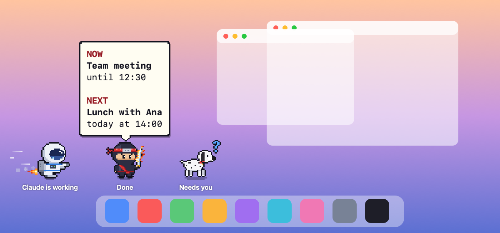
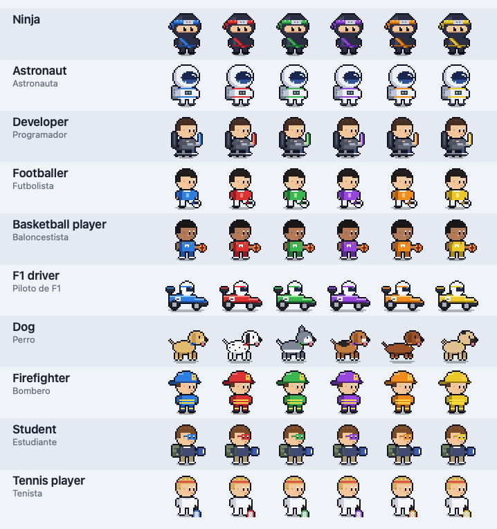
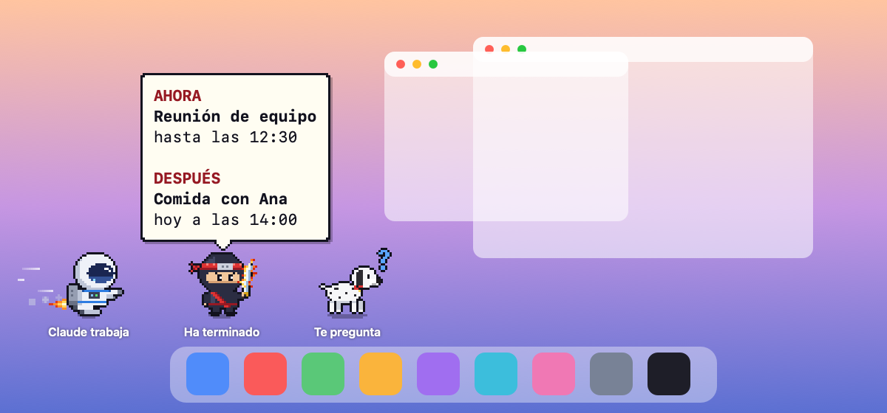

<p align="center"></p>

# PixelBuddy

A tiny pixel art buddy that lives above your Dock on macOS, reacts to what **Claude Code**
is doing, and shows your calendar with one click. Pick one of **10 characters**: ninja,
astronaut, developer, footballer, basketball player, F1 driver, dog, firefighter, student or
tennis player.

*[Leer en español ↓](#español)*

<p align="center"></p>

<p align="center"></p>

| Claude Code… | Your buddy |
|---|---|
| is working | runs, flies, dribbles or drives back and forth |
| finished | celebrates for 30 s (katana, flag, goal, basket, A+…) |
| asks you something or needs permission | blue **?** |
| stopped on an error | red **!** |
| waits for your next message | trains, stretches, juggles, reads… (1 min) |
| has been idle | sleeps, Zzz |

- **Several sessions at once.** You can have several Claude Code sessions open in the same
  project folder at the same time: each one gets its own buddy, and they all work
  independently — one can be running while another celebrates and a third asks you
  something. The color tells you which session is which: the first session you open is
  blue, the second red, then green, purple, orange and yellow (the dog changes breed
  instead). When they are idle they stand side by side without overlapping.
- Click a buddy to see your current event and your next one today, from the macOS Calendar
  (iCloud, Google… any account added in *System Settings › Internet Accounts*).
- It only reacts to sessions opened in **your project folder** (and its subfolders).
- Native Swift app, no dependencies, no network, free.

## Characters

Pick yours in the welcome window or in the menu bar (*Character ▸*). Each Claude Code session
gets the next color in order; the dog changes breed instead (labrador, dalmatian, husky,
beagle, dachshund, pug), with a collar in the session color.

<p align="center"></p>

## Requirements

- macOS 14 Sonoma or later
- Xcode Command Line Tools (`xcode-select --install`; full Xcode is not needed)
- Claude Code (desktop app or CLI)

## Install

```bash
git clone https://github.com/rubenbenitoferrando-sketch/PixelBuddy.git
cd PixelBuddy
./scripts/install.sh
```

The script builds the app on your Mac and installs it in `~/Applications`. PixelBuddy then
opens a welcome window where you:

1. pick your character,
2. choose your project folder — and tick **Connect Claude Code** (it adds PixelBuddy's hooks
   to that folder's personal `.claude/settings.local.json`, backing it up first),
3. optionally allow Calendar access.

Close and reopen your Claude Code sessions in that folder, and your buddy comes to life.

### Prefer the Claude Code plugin?

Instead of ticking *Connect Claude Code*, you can install the hooks as a plugin. Inside a
Claude Code session opened in your project folder:

```
/plugin marketplace add rubenbenitoferrando-sketch/PixelBuddy
/plugin install pixelbuddy@pixelbuddy
```

Choose the **local** scope (only this project, only you). You still need the app: the plugin
just tells it what Claude Code is doing.

## Using it

- **Click a buddy** → speech bubble with your current event (and when it ends) and your next
  one today, or "You can relax". It closes on the next click or after 8 seconds.
- **✕ Remove** in the bubble removes a buddy whose session you no longer use. If that session
  starts working again, its buddy comes back. When there are no sessions, a main buddy stays
  so you can always check your calendar.
- **Menu bar icon**: character, show/hide, calendars, watched folder, set up, **How It Works…** (a short animated guide that also opens right after the welcome window), open at login, quit.

## Privacy

Everything stays on your Mac. The hook writes one small file per session to
`~/Library/Application Support/PixelBuddy/sessions/` with the session id, folder, event name,
tool name or notification type, and time — nothing from your prompts or code. Events from
other folders are ignored. The calendar is read locally through EventKit. PixelBuddy makes no
network requests.

## Uninstall

```bash
./scripts/uninstall.sh
```

It removes the hooks from your project folder, the login item, the app, its data and its
settings (backups of `settings.local.json` are kept). If you used the plugin:
`/plugin uninstall pixelbuddy@pixelbuddy`.

## Add your own character

Each character is a folder in `assets/avatars/<id>/` with a `manifest.json` and one sprite
strip per color and state (`<prefix>_<color>_<state>.png`, 32×32 frames; states `idle`, `run`,
`katana`, `train`, `sleep`, `alert`, `ask`). The app finds new folders automatically.
The ninja and astronaut are generated with `tools/make_sprites.py` and
`tools/make_astronaut.py`; the other eight with `tools/make_characters.py` from
`tools/chars/` (they all need Pillow). `tools/preview_characters.py` makes a preview GIF.

## Development

- Swift Package (macOS 14+) in `Sources/PixelBuddy/`. `scripts/build_app.sh` builds with
  `swift build -c release`, assembles `PixelBuddy.app`, signs it and installs it.
- `scripts/simulate.sh` plays fake sessions through every state, without real work.
- README images: `swift tools/make_readme_images.swift` (scenes and gallery) and
  `python3 tools/make_readme_gif.py` (animation).
- Optional: `scripts/create_signing_cert.sh` creates a local signing certificate so macOS
  keeps the Calendar permission across rebuilds (asks for your Mac password once).
- The hook script is `plugins/pixelbuddy/scripts/pixelbuddy-hook.sh`; the plugin catalog is
  `.claude-plugin/marketplace.json`.

PixelBuddy is an independent project, not affiliated with or endorsed by Anthropic.
Claude and Claude Code are trademarks of Anthropic.

---

## Español

Un pequeño compañero pixel art que vive encima del Dock de tu Mac. Te muestra de un vistazo
qué está haciendo **Claude Code** y, si haces clic en él, te enseña tu calendario. Puedes
elegir entre **10 personajes**: ninja, astronauta, programador, futbolista, baloncestista,
piloto de F1, perro, bombero, estudiante y tenista.

<p align="center"></p>

### Qué significa cada animación

| Si Claude Code… | Tu personaje… |
|---|---|
| está trabajando | corre, vuela, bota el balón o conduce de un lado a otro |
| ha terminado | lo celebra durante 30 segundos (katana, bandera, gol, canasta, A+…) |
| te hace una pregunta o necesita tu permiso | muestra una **?** azul |
| se ha parado por un error | muestra una **!** roja |
| espera tu siguiente mensaje | entrena, se estira, hace toques, lee… (1 minuto) |
| lleva un rato sin actividad | se duerme (Zzz) |

- **Varias sesiones a la vez.** Puedes tener abiertas varias sesiones de Claude Code en la
  misma carpeta de proyecto al mismo tiempo: cada una tiene su propio personaje y funcionan
  por separado. Uno puede estar trabajando mientras otro celebra y un tercero te pregunta
  algo. El color te dice qué sesión es cuál: la primera que abres es azul, la segunda roja y
  después verde, morada, naranja y amarilla (en el perro cambia la raza). Cuando están
  quietos se colocan uno al lado del otro, sin taparse.
- Al hacer clic en un personaje verás tu evento actual y el siguiente de hoy, sacados del
  Calendario de macOS. Sirve cualquier cuenta que tengas añadida en
  *Ajustes del Sistema › Cuentas de internet* (iCloud, Google…).
- Solo reacciona a las sesiones que abras en **tu carpeta de proyecto** (y sus subcarpetas).
- Es una app nativa, gratuita, sin dependencias externas y sin conexión a internet.

### Personajes

Elige el tuyo en la ventana de bienvenida o en la barra de menús (*Personaje ▸*). Cada sesión
nueva recibe el siguiente color; el perro cambia de raza (labrador, dálmata, husky, beagle,
salchicha y carlino) y lleva un collar del color de su sesión.

<p align="center"></p>

### Qué necesitas

- macOS 14 Sonoma o posterior.
- Las herramientas de línea de comandos de Xcode (*Command Line Tools*). Si no las tienes,
  abre la app **Terminal** y escribe `xcode-select --install`; no hace falta Xcode completo.
- Claude Code (la app de escritorio o la versión de terminal).

### Instalación

Abre la app **Terminal** (está en *Aplicaciones › Utilidades*) y copia estos tres comandos,
uno detrás de otro:

```bash
git clone https://github.com/rubenbenitoferrando-sketch/PixelBuddy.git
cd PixelBuddy
./scripts/install.sh
```

- El primero descarga PixelBuddy en tu Mac.
- El segundo entra en la carpeta que se acaba de descargar.
- El tercero compila la app y la instala en tu carpeta `~/Applications`.

Al terminar se abre la **ventana de bienvenida**, donde:

1. eliges tu personaje;
2. eliges tu carpeta de proyecto (la que abres en Claude Code) y marcas
   **Conectar Claude Code**. Así PixelBuddy añade sus avisos al archivo personal
   `.claude/settings.local.json` de esa carpeta, después de hacer una copia de seguridad;
3. si quieres, das acceso al Calendario.

Después se abre una guía corta, **Cómo funciona**, con todas las animaciones explicadas.
Por último, cierra y vuelve a abrir tus sesiones de Claude Code en esa carpeta para que tu
personaje empiece a reaccionar.

#### Alternativa: el plugin de Claude Code

En lugar de marcar *Conectar Claude Code*, puedes instalar los avisos como un plugin. Abre una
sesión de Claude Code en tu carpeta de proyecto y escribe:

```
/plugin marketplace add rubenbenitoferrando-sketch/PixelBuddy
/plugin install pixelbuddy@pixelbuddy
```

Cuando te pregunte dónde instalarlo, elige el alcance **local** (solo este proyecto y solo
para ti). La app sigue siendo necesaria: el plugin solo le cuenta lo que hace Claude Code.

### Uso

- **Clic en un personaje:** aparece un bocadillo con tu evento actual (y hasta qué hora dura)
  y el siguiente de hoy. Si no tienes nada, pone *Puedes descansar*. Se cierra con otro clic
  o a los 8 segundos.
- **✕ Quitar** (dentro del bocadillo): retira el personaje de una sesión que ya no usas. Si
  esa sesión vuelve a trabajar, el personaje reaparece. Cuando no hay ninguna sesión, queda
  un personaje principal para que siempre puedas consultar el calendario.
- **Icono de la barra de menús** (arriba a la derecha): cambiar de personaje, mostrarlos u
  ocultarlos, elegir calendarios, cambiar la carpeta vigilada, volver a la bienvenida, abrir
  la guía *Cómo funciona*, activar el arranque al iniciar sesión y salir.

### Privacidad

Todo se queda en tu Mac. Por cada sesión se guarda un archivo pequeño en
`~/Library/Application Support/PixelBuddy/sessions/` con el identificador de la sesión, la
carpeta, el tipo de aviso, el nombre de la herramienta y la hora. **Nunca** se guarda lo que
escribes ni tu código. Los avisos de otras carpetas se ignoran, el calendario se lee
directamente en tu Mac y PixelBuddy no se conecta a internet.

### Desinstalar

Desde la carpeta de PixelBuddy, en Terminal:

```bash
./scripts/uninstall.sh
```

Quita los avisos de tu carpeta de proyecto, el arranque al iniciar sesión, la app, sus datos y
sus ajustes (las copias de seguridad de `settings.local.json` se conservan). Si usaste el
plugin, escribe también en Claude Code: `/plugin uninstall pixelbuddy@pixelbuddy`.

---

Licencia MIT. PixelBuddy es un proyecto independiente, sin relación con Anthropic ni
respaldado por ella. Claude y Claude Code son marcas de Anthropic.
